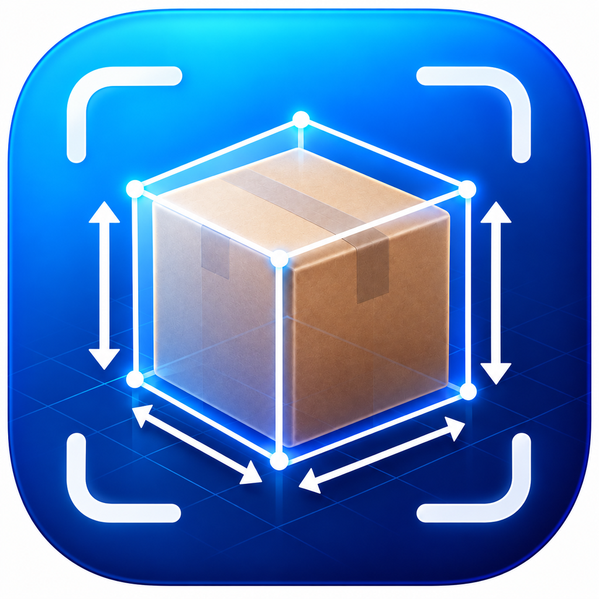
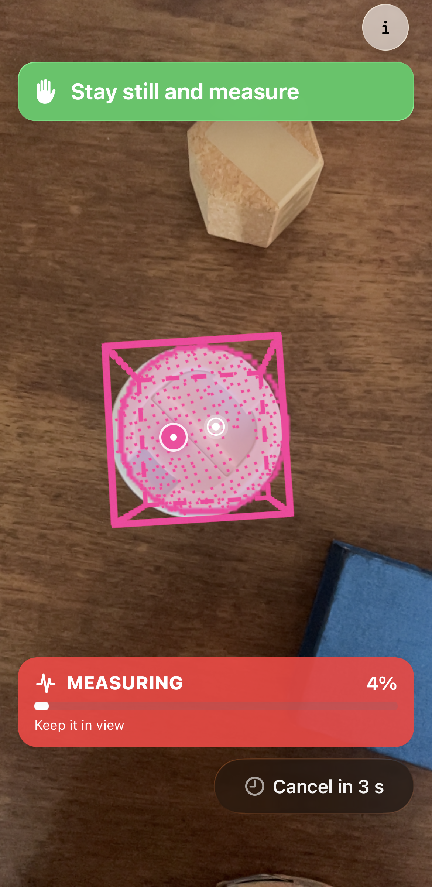
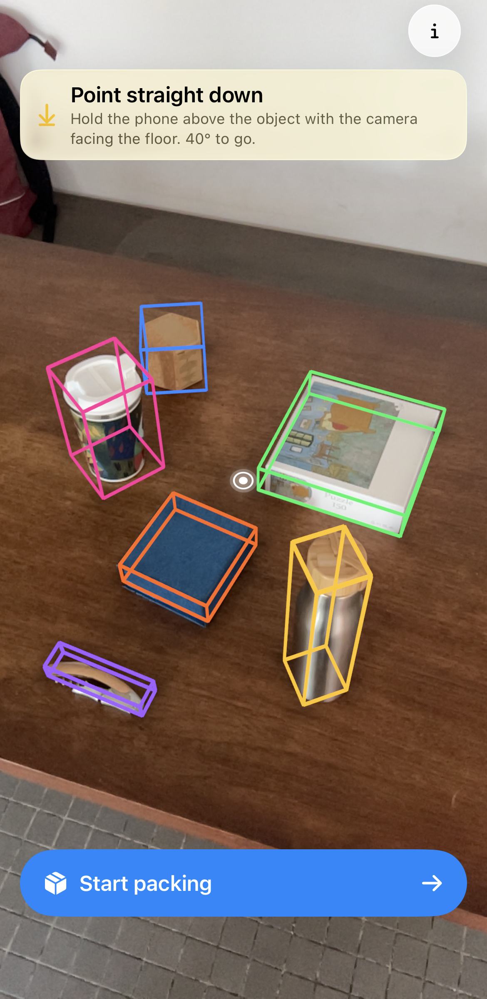
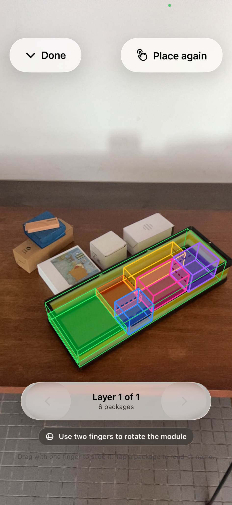

# PayloadMeasure

PayloadMeasure is a native iOS research prototype for measuring objects with a LiDAR-equipped iPhone. It combines Apple Vision foreground-instance segmentation with ARKit camera tracking and scene depth to fit and display oriented 3D bounding boxes. Operators can inspect a measurement, lock it, and save an object with a name and manually entered weight.

The app was developed for the master's thesis *Using Computer Vision for Guiding Payload Distribution in Modular Drone Delivery Systems* at the Technical University of Munich, in collaboration with the University of Cambridge's Cyber-Human Lab. The larger research project explores how object assessment can feed modular drone payload planning and AR-guided preparation. **This repository contains the measurement application, not the complete packing and placement workflow described in the thesis.**

## In the app

- Live camera view with AR world tracking, horizontal support-plane detection, and LiDAR scene depth.
- Apple Vision foreground-instance masks for selecting and tracking multiple objects.
- Mask-gated depth accumulation, point filtering, and oriented 3D box fitting.
- Two automatic measurement methods: **Full 3D** and **Top**. The method is selected in the Information panel.
- On-screen measurement progress, lock and save flow, and retained boxes for previously measured objects.
- Runtime capability checks: devices without LiDAR can show RGB masks, but cannot perform metric depth capture.

## Screenshots

The images below are application captures from the thesis. The first two show the measurement flow implemented in this repository. The final image illustrates the downstream AR placement work in the broader thesis system.

| Measuring an object | Reviewing measured objects |
| --- | --- |
|  |  |
| A Vision mask selects object pixels while LiDAR samples build a 3D box over time. The progress card shows when the measurement is ready to lock. | Each saved object retains a distinct colored box in the AR scene, so the operator can review measurements before the next step. |

**Broader thesis workflow:** The AR view below overlays a calculated arrangement in a physical payload module. It shows the intended use of measured dimensions in payload preparation; the packing and placement implementation shown here is outside this repository.

## Build and run

1. Open `PayloadMeasure.xcodeproj` in Xcode 26.5 or later.
2. Select the `PayloadMeasure` scheme and an iPhone with a LiDAR Scanner for metric measurement. The project deployment target is iOS 26.5.
3. For a device build, choose your own signing team and replace the example bundle identifier in the target's Signing & Capabilities settings as needed.
4. Build and run, grant camera access, and allow ARKit to establish tracking and a horizontal support plane before scanning.

The simulator cannot validate camera tracking or LiDAR measurement. A non-LiDAR iPhone can be used to inspect the RGB masking and unsupported-hardware guidance.

## How it is organized

| Area | Main files |
| --- | --- |
| App and SwiftUI composition | `PayloadMeasure/PayloadMeasureApp.swift`, `PayloadMeasure/ContentView.swift`, `mesoverlayview.swift` |
| AR session and rendering | `ARSessionManager.swift`, `ARCameraView.swift` |
| Vision mask processing | `ObjectMaskProcessor.swift` |
| Capture state and geometry | `ObjectCaptureEngine.swift`, `ObjectCapture.swift`, `PayloadMeasure/MeasurementConvergence.swift` |
| Measurement modes and supporting state | `mesmode.swift`, `mesengine.swift`, `mespoint.swift` |

The active segmentation path uses Apple's Vision framework. ARKit depth and support-plane data provide the metric measurements; saved object weight is supplied by the operator rather than inferred from the camera.

## Research context and limits

The thesis evaluated a combined assisted workflow against ruler measurement, manual dimension entry, and on-screen 3D guidance in a 16-participant study. In that study, the combined workflow shortened mean total preparation time by 26.0% and received higher usability and lower workload scores. The comparison does not isolate the effect of this measurement app or AR guidance alone. It did not establish a statistically significant reduction in errors or placement time, and independent dimensional accuracy and operational flight suitability remain to be validated.

This code is a thesis prototype intended for inspection and further research, not a validated flight-safety or logistics product.
